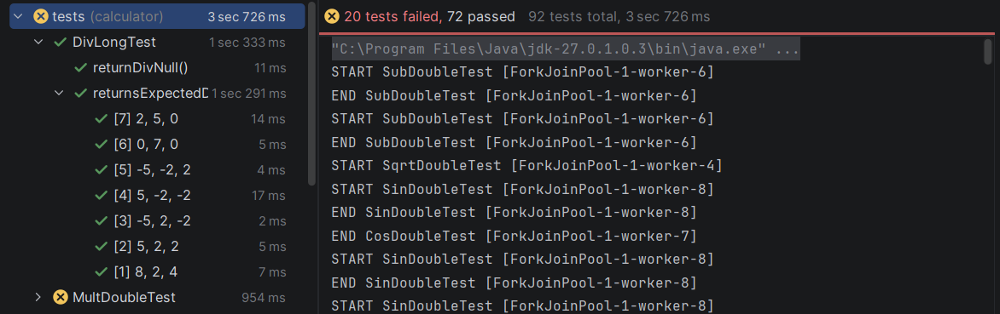

# Calculator Unit Tests

Unit tests for the supplied `Calculator-1.0.jar` library using JUnit 5 and IntelliJ IDEA.

## Assignment

- Add `Calculator-1.0.jar` as a project dependency.
- Write unit tests using JUnit or TestNG. Create a separate test class for each library method.
- Use test framework annotations for preconditions and postconditions.
- Demonstrate data-driven testing with parameterized tests.
- Configure and run the tests in parallel using the test framework.
- Run the tests in the IDE and include screenshots of the results.
- For TestNG only, create and run an XML suite with at least one group. Use the suite to select tests by group or demonstrate a dependency on that group.

## Project setup

1. Open the project in IntelliJ IDEA and select a Java SDK, such as JDK 21.
2. If the calculator library is missing from the module dependencies, place the supplied JAR in `lib/` and add it through **File → Project Structure → Modules → Dependencies → + → JARs or Directories**.
3. JUnit 5 was added through **File → Project Structure → Libraries → + → From Maven** using the coordinates `org.junit.jupiter:junit-jupiter:5.13.4`. If you need to add it again, enable **Download transitive dependencies** and attach the library to the project module.
4. Verify that `test/` is marked as **Test Sources Root** and `test-resources/` as **Test Resources Root**.

## Test structure and execution

- Each of the 16 public calculator method signatures has a dedicated test class under `test/calculator/tests/`.
- `BaseTest` creates a fresh calculator in `@BeforeEach`. Assertions verify the expected results. The calculator has no resources that require cleanup. The `@AfterEach` hook logs the end of each invocation for the parallel-run demonstration.
- `@ParameterizedTest` and `@CsvSource` provide multiple input and expected-result combinations.
- `test-resources/junit-platform.properties` enables parallel execution.

To run the suite in IntelliJ IDEA, right-click the `calculator.tests` package and select **Run 'Tests in calculator.tests'**.

## IDE results

**92 test invocations — 72 passed and 20 failed.** The screenshot shows parameterized cases in `DivLongTest` and overlapping execution on different worker threads.

